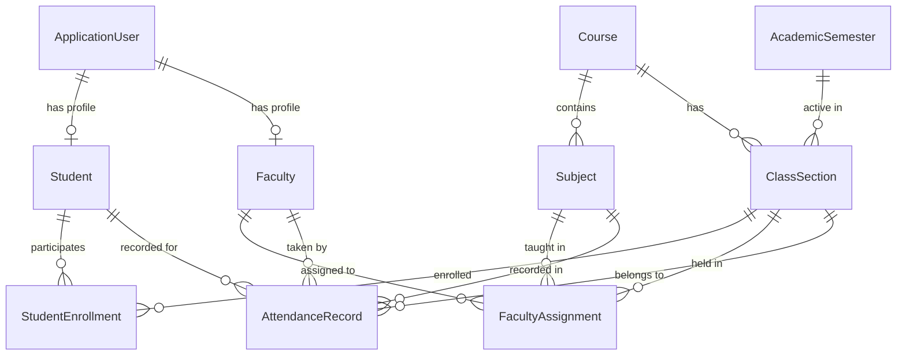

# 🎓 Smart Attendance Management System

A full-stack, enterprise-grade **Smart Attendance Management System** developed with **ASP.NET Core 8 MVC**, **C#**, **Entity Framework Core**, **SQL Server** (with seamless zero-setup SQLite fallback), **ASP.NET Core Identity**, and modern **Bootstrap 5 UI/UX**.

Designed specifically for **B.Tech Computer Science and Engineering semester project evaluation and viva demonstration**.

---

## 📌 Table of Contents
1. [Key Features](#-key-features)
2. [Technology Stack](#-technology-stack)
3. [System Architecture & Design Patterns](#-system-architecture--design-patterns)
4. [User Roles & Access Control](#-user-roles--access-control)
5. [Attendance Calculation Formula](#-attendance-calculation-formula)
6. [Database Schema & Entity Relationships](#-database-schema--entity-relationships)
7. [Database Setup: SQL Server & SQLite](#-database-setup-sql-server--sqlite)
8. [Quick Start & Running in Visual Studio](#-quick-start--running-in-visual-studio)
9. [Pre-Seeded Demo Accounts](#-pre-seeded-demo-accounts)
10. [Viva / Semester Project Defense Guide](#-viva--semester-project-defense-guide)

---

## 🌟 Key Features

- **🔐 ASP.NET Core Identity & Role-Based Access Control (RBAC):**
  - Three distinct roles: **Admin**, **Faculty**, and **Student**.
  - Secure password hashing (PBKDF2 with HMAC-SHA256), session cookies, and Anti-Forgery token protection against CSRF.
  - Strict privacy: Students can only view their own records; faculty only manage assigned subjects.

- **⚡ Fast Classroom Attendance Marking:**
  - One-click **"All Present"** batch action with live interactive toggles for **Present**, **Absent**, and **Late**.
  - Live statistics counter displaying real-time attendance rate before submission.
  - Audit trail tracking (`RecordedByFacultyId`, `CreatedAt`, `ModifiedAt`, `ModifiedByUserId`).
  - Strict database composite uniqueness constraint (`StudentId + SubjectId + ClassSectionId + Date`) preventing duplicate entries.

- **📊 Interactive Analytics & Dashboards:**
  - **Admin Dashboard:** Real-time statistics, 7-day attendance trend line charts (Chart.js), subject averages bar charts, recent activity feed, and critical defaulter highlights.
  - **Faculty Dashboard:** Personal teaching schedule, today's attendance status indicators, and subject performance summaries.
  - **Student Dashboard:** Cumulative attendance gauge, subject-by-subject progress bars, monthly charts, and recent attendance history.

- **🚨 Automated Low Attendance Defaulter Alerts (< 75%):**
  - Visual warning banners displayed on student dashboards if cumulative attendance drops below 75%.
  - Dedicated **Defaulters Report** calculating the exact number of consecutive classes a student must attend to cross the 75% threshold.

- **📑 Reports & Data Export:**
  - **Daily Session Reports** with classroom breakdown.
  - **Subject-Wise Attendance Ledgers** with date range filtering.
  - **Student-Wise Attendance Dossiers** detailing complete date-by-date history.
  - Clean printer-friendly stylesheets (`@media print`) and **1-click CSV Export** for institutional audits.

---

## 🛠 Technology Stack

| Layer | Technologies |
|---|---|
| **Frontend** | HTML5, CSS3, Vanilla CSS Design System, Bootstrap 5.3, Bootstrap Icons, Chart.js |
| **Backend Framework** | ASP.NET Core 8.0 MVC (C# 12) |
| **ORM / Data Layer** | Entity Framework Core 8.0 (Code-First) |
| **Primary Database** | Microsoft SQL Server / LocalDB |
| **Portable Fallback** | SQLite (zero-configuration local testing out of the box) |
| **Security & Auth** | ASP.NET Core Identity with Cookie Authentication & Anti-Forgery Protection |
| **Development IDE** | Visual Studio 2022 / Visual Studio Code / .NET 8 CLI |

---

## 🏛 System Architecture & Design Patterns

The project follows a standard, decoupled **Model-View-Controller (MVC) + Service Layer Architecture**:

```
SmartAttendance/
├── Controllers/            # Handles HTTP requests, authorization, and view routing
│   ├── AccountController.cs        # Login, Logout, Profile, Password Change
│   ├── DashboardController.cs      # Role-specific dashboard gateways
│   ├── AttendanceController.cs     # Take attendance, sheet retrieval, history
│   ├── ReportsController.cs        # Daily, Subject, Student, Defaulter reports, CSV export
│   ├── StudentsController.cs       # Student CRUD & account provisioning
│   ├── FacultyController.cs        # Faculty CRUD & account provisioning
│   └── AcademicController.cs       # Courses, Subjects, Sections, Allocations, Semesters
├── Data/                   # Database Context & Seed Initializer
│   ├── ApplicationDbContext.cs     # EF Core DbContext with Fluent API constraints
│   └── DbInitializer.cs            # Automatic migration & realistic mock data seeder
├── Models/                 # Core Domain Entities
│   ├── ApplicationUser.cs          # Extended IdentityUser
│   ├── Student.cs, Faculty.cs      # Academic profile models
│   ├── Course.cs, Subject.cs       # Curriculum models
│   ├── ClassSection.cs, Semester.cs# Classroom & session models
│   └── AttendanceRecord.cs         # Audit-logged attendance transaction
├── Services/               # Encapsulated Business Logic & Calculations
│   ├── IAttendanceService.cs       # Attendance operations & status aggregation
│   ├── IDashboardService.cs        # Metrics, chart formatting, activity streams
│   └── IReportService.cs           # Report generation, defaulter math, CSV serialization
├── ViewModels/             # Strongly typed ViewModels separating presentation from domain
│   ├── Account/, Dashboard/, Attendance/, Reports/, Management/
├── Views/                  # Razor Views & Partials styled with commercial CSS
└── wwwroot/                # Static assets (CSS Design System, JS helpers, icons)
```

---

## 👥 User Roles & Access Control

| Role | Permissions & Capabilities |
|---|---|
| **Admin** | Full system control: Manage Students, Faculty, Courses, Subjects, Class Sections, Academic Terms, and Faculty Allocations. Access institutional analytics and download audit reports. |
| **Faculty** | View assigned timetable and class sections. Take daily attendance with 1-click batch tools, modify attendance with audit logging, inspect subject summaries and defaulter lists. |
| **Student** | Secure view of personal attendance dashboard only. View subject-wise percentages, low attendance warnings (< 75%), recent timeline, and update profile security. |

---

## 📐 Attendance Calculation Formula

Attendance percentage is calculated consistently across the entire system using the following weighted policy:

$$\text{Counted Sessions} = \text{Present} + \text{Late} + \text{Absent}$$

$$\text{Attended Credits} = (\text{Present} \times 1.0) + (\text{Late} \times 0.5)$$

$$\text{Attendance Percentage} = \left( \frac{\text{Attended Credits}}{\text{Counted Sessions}} \right) \times 100$$

### 💡 Defaulter Recovery Math (Viva Highlight):
For a student with attendance below 75% seeking eligibility, the system computes the minimum consecutive classes ($x$) they must attend:

$$x = \left\lceil \frac{0.75 \times \text{TotalSessions} - \text{AttendedCredits}}{1.0 - 0.75} \right\rceil$$

---

## 🗄 Database Schema & Entity Relationships



### Unique Database Constraints:
- `Students`: Unique on `RollNumber`
- `Faculties`: Unique on `FacultyCode`
- `Courses`: Unique on `Code`
- `Subjects`: Unique on `Code`
- `AttendanceRecords`: **Composite Unique Index** on `(StudentId, SubjectId, ClassSectionId, Date)` — prevents duplicate attendance records for the same student, subject, class, and date.

---

## 💾 Database Setup: SQL Server & SQLite

The application is engineered with **Dual Database Provider Support**.

### Option A: Microsoft SQL Server (Default Production / Lab Environment)
1. In `appsettings.json`, set:
   ```json
   "DatabaseProvider": "SqlServer",
   "ConnectionStrings": {
     "DefaultConnection": "Server=(localdb)\\mssqllocaldb;Database=SmartAttendanceDb;Trusted_Connection=True;MultipleActiveResultSets=true;TrustServerCertificate=True"
   }
   ```
2. For SQL Server Express:
   `"Server=localhost\\SQLEXPRESS;Database=SmartAttendanceDb;Trusted_Connection=True;TrustServerCertificate=True"`
3. Run migrations or let `DbInitializer.SeedAsync` create the schema automatically on first boot!

### Option B: SQLite (Instant, Zero-Config Portable Testing)
1. In `appsettings.json`, set:
   ```json
   "DatabaseProvider": "Sqlite",
   "ConnectionStrings": {
     "SqliteConnection": "Data Source=SmartAttendance.db"
   }
   ```
2. No database server installation required. A local database file `SmartAttendance.db` is initialized and pre-seeded automatically on first run!

---

## 🚀 Quick Start & Running in Visual Studio

### Prerequisites:
- [.NET 8 SDK](https://dotnet.microsoft.com/download/dotnet/8.0)
- Visual Studio 2022 (with ASP.NET and web development workload) OR Visual Studio Code

### Method 1: Using Visual Studio 2022
1. Open Visual Studio 2022.
2. Select **Open a project or solution**, and browse to `AttendanceSystem/SmartAttendance.csproj`.
3. Press **F5** or the green **Run** button.
4. The database is initialized and populated with mock data automatically. The browser will open directly to the login portal!

### Method 2: Using .NET CLI
```bash
# Clone or navigate to the directory
cd AttendanceSystem

# Restore NuGet packages
dotnet restore

# Build solution
dotnet build

# Run application
dotnet run
```
Open your browser and navigate to: `http://localhost:5025` (or the port shown in your terminal).

---

## 🔑 Pre-Seeded Demo Accounts

The login portal includes **1-Click Auto-Fill Demo Buttons** so examiners can test every role effortlessly:

| Role | Email Address | Password | Profile Description |
|---|---|---|---|
| **Admin** | `admin@smartattendance.edu` | `Admin@123` | System Administrator (Full Access) |
| **Faculty (HOD)** | `faculty.sharma@smartattendance.edu` | `Faculty@123` | Dr. Rajesh Sharma (Professor & HOD, CS) |
| **Faculty** | `faculty.patel@smartattendance.edu` | `Faculty@123` | Prof. Anita Patel (Assistant Professor) |
| **Faculty** | `faculty.verma@smartattendance.edu` | `Faculty@123` | Prof. Vikram Verma (Associate Professor) |
| **Student (Eligible)** | `student.rahul@smartattendance.edu` | `Student@123` | Rahul Kumar (Roll: `26BCSE01`, >85% attendance) |
| **Student (Defaulter)** | `student.rohit@smartattendance.edu` | `Student@123` | Rohit Verma (Roll: `26BCSE05`, <75% attendance alert) |
| **Student (Defaulter)** | `student.sneha@smartattendance.edu` | `Student@123` | Sneha Reddy (Roll: `26BCSE08`, <75% attendance alert) |

*(Note: Users can change their password at any time via the User Profile page).*

---

## 🎓 Viva / Semester Project Defense Guide

When demonstrating this project to internal and external examiners, use the following structured script:

1. **Architecture & Separation of Concerns:**
   - Highlight that business logic is completely isolated in `Services/` (`AttendanceService`, `DashboardService`, `ReportService`), keeping controllers lightweight and views strongly typed with `ViewModels/`.
2. **Security & Identity:**
   - Explain how `ApplicationUser` extends `IdentityUser`. Explain that passwords are not stored in plaintext, but salted and hashed using PBKDF2.
   - Point out `[Authorize(Roles = "Admin")]` and `[ValidateAntiForgeryToken]` ensuring zero CSRF vulnerability.
3. **Preventing Duplicate Attendance:**
   - Demonstrate the composite index on `(StudentId, SubjectId, ClassSectionId, Date)` in `ApplicationDbContext.cs`. Even if a user clicks twice or submits twice, the database enforces single-record integrity.
4. **Attendance Calculation & Defaulter Warning:**
   - Log in as `student.rohit@smartattendance.edu` and show the red **Low Attendance Warning Banner (< 75%)**.
   - Show how the system computes the exact recovery count: "+7 consecutive classes needed to restore eligibility".
5. **Class Attendance Marking Demonstration:**
   - Log in as `faculty.sharma@smartattendance.edu`. Select CSE-5A and DBMS.
   - Show the **"All Present"** shortcut, flip a student to "Late" or "Absent", and demonstrate real-time count updating in the UI.
   - Click Save, and verify the audit fields (`ModifiedAt`, `RecordedByFacultyId`).
6. **Reporting & Auditing:**
   - Show the **Daily Report**, **Subject-Wise Ledger**, and click **"Export CSV"** to demonstrate immediate offline report capability for university compliance.
